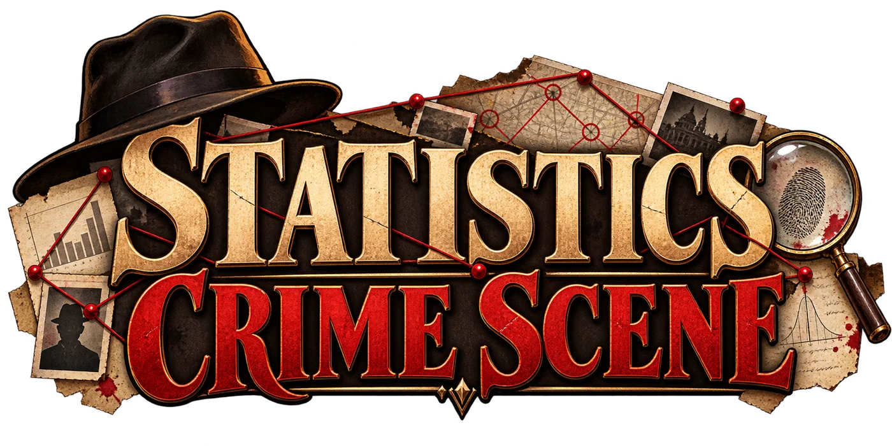

<div align="center">
  

  # Statistics Crime Scene｜統計犯罪現場

  **數字不會說謊，但數字也不會告訴你全部的真相。**

  <a href="https://itzel0115.github.io/statistics-crime-scene/"><strong>▶ Play Online｜立即遊玩</strong></a>
</div>

## About the Game｜遊戲介紹

這是一款結合統計推論與偵探解謎的互動式網頁遊戲。你將扮演統計調查員，在復古偵探辦公室裡翻查新聞、研究報告與被忽略的資料。打開證物、操作分析工具，從資料中找出值得追問的地方，再親自為案件提出結論。

遊戲包含偵探敘事、互動分析、證物探索、案件推理，以及記錄調查成果的成就徽章。每宗案件都邀請你多看一眼資料是如何被整理與比較。

## Three Cases｜三宗案件

### CASE 001 — 三倍投訴的販賣機

校園新聞把投訴增加寫成設備故障的證據。檢查交易紀錄與客訴資料，看看總數之外還有哪些比較方式值得考慮。（統計概念：比例與分母）

### CASE 002 — 消失的冠軍學院

一份總排名讓兩所學院的表現看起來一目了然。拆開不同組別的資料，重新思考整體結果如何形成。（統計概念：分層比較與混雜因素）

### CASE 003 — 被挑選的奇蹟實驗

研究摘要只留下最醒目的結果，完整實驗紀錄仍在案卷裡。檢查分析流程，判斷一項發現需要什麼樣的確認。（統計概念：多重比較與研究設計）

## Gameplay｜遊戲玩法

接受委託、翻閱證物、將線索帶到分析工作台，嘗試不同的圖表或比較方式，再提出結論。完成案件後會收到結案說明與徽章；調查進度會保存在目前瀏覽器中。

<div align="center">
  
  <br>
  <sub>偵探桌：選擇案卷，開始調查。</sub>
</div>

## Built With｜開發方式

- HTML、CSS 與 Vanilla JavaScript，無需建置工具或外部 API。
- SVG 動態圖表呈現分析結果。
- GitHub Pages 靜態部署；遊戲進度使用瀏覽器 `localStorage` 儲存。
- AI-assisted / Vibe Coding：由人類進行創意設計、內容審查、互動測試與反覆迭代。概念與遊戲規格設計過程使用 ChatGPT 協作，並以 AI 生成美術素材；互動程式則透過 Codex 開發與修改。

## Run Locally｜本機執行

直接在瀏覽器開啟 `index.html` 即可遊玩。也可以在專案根目錄啟動 Python 靜態伺服器：

```bash
python -m http.server 8000
```

接著前往 <http://localhost:8000>。

## Credits & Attribution｜素材與授權

遊戲中的視覺素材為本專案製作的 AI-generated artwork。

手寫字型 **芫荽 Iansui** 取自 [ButTaiwan/Iansui](https://github.com/ButTaiwan/iansui)，專案中使用其精簡字集，並以 **Crime Scene Notes** 名稱呈現。字型依 [SIL Open Font License 1.1](asset/fonts/OFL.txt) 授權；來源與字型資訊見 [`asset/fonts/SOURCE.json`](asset/fonts/SOURCE.json)。
